# Rapport — Phase 2 : Mise en place du pipeline sur Microsoft Azure

- **Abonnement** : `Azure for Students` | **Data Factory** : `kcrowlytest` (`YouCode`) | **Data Lake** : `kcrowly` (`YouCode`) | **Azure ML** : `mlpipe` (`itzhaso71-rg`, `spaincentral`)
- **Données** : `electro.csv` (`Datetime`, `PJME_MW` — `3,882 MiB`)

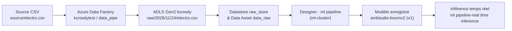

---

## Étape 1 : Ingestion des données

- **Azure Data Factory** `kcrowlytest` (groupe `YouCode`) avec le pipeline `data_pipe` et l'activité **Copy Data** (`Copy data1`).
- **Source** (`ElectricitySource`) : fichier CSV `source/electro.csv` via le service lié `get_raw_data` (délimiteur `,`, encodage `UTF-8`, première ligne en en-tête).
- **Destination & validation** (`ElectricityRaw`) : schéma validé sur deux colonnes (`Datetime`, `PJME_MW`) et copie vers ADLS Gen2.

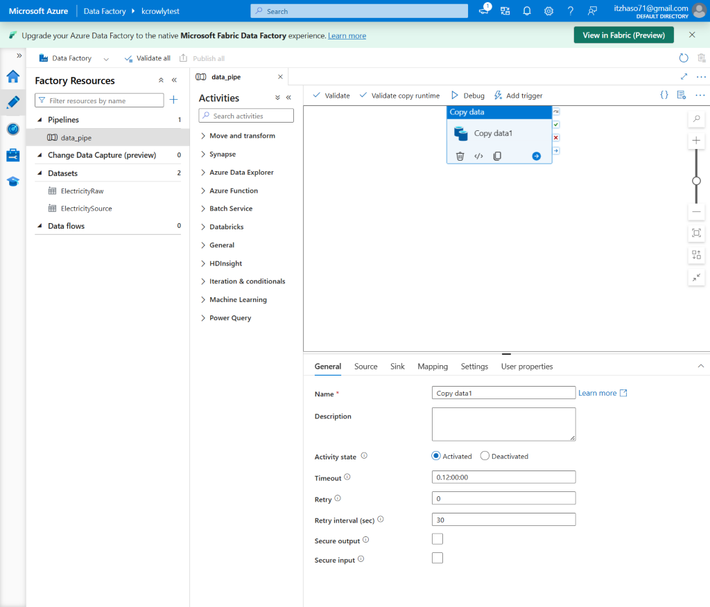

---

## Étape 2 : Organisation du Data Lake

- Stockage des données brutes non modifiées dans **Azure Data Lake Storage Gen2** (`kcrowly`, conteneur `raw`).
- Chemin dynamique horodaté configuré dans `ElectricityRaw` : `raw/@formatDateTime(utcnow(), 'yyyy/MM/dd')/electro.csv`.
- Fichier déposé et vérifié dans l'arborescence : `raw/2026/11/24/electro.csv`.

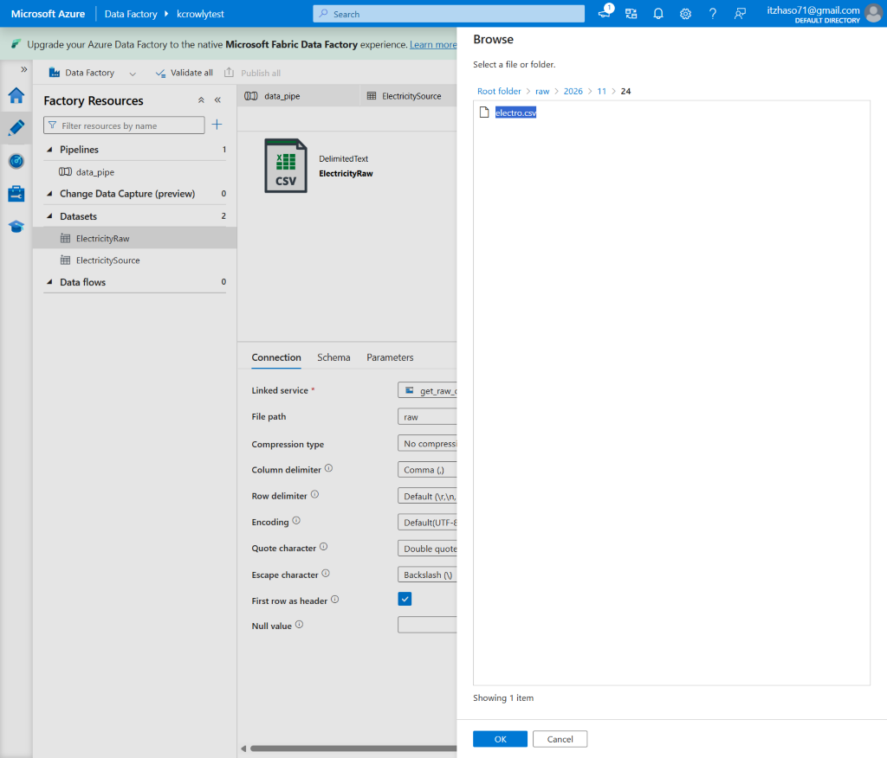

---

## Étape 3 : Configuration d’Azure Machine Learning

- Espace de travail **Azure Machine Learning** `mlpipe` (groupe `itzhaso71-rg`, région `spaincentral`).
- **Datastore** `raw_store` (type `Azure Data Lake Storage Gen2`) pointant vers `https://kcrowly.dfs.core.windows.net/raw`.
- **Compute cluster** `ml-cluster` : VM `Standard_DS3_v2` (4 vCPU, 14 Go RAM), tier `Dedicated`, `0` à `1` nœud, mise en veille après `120 s`.

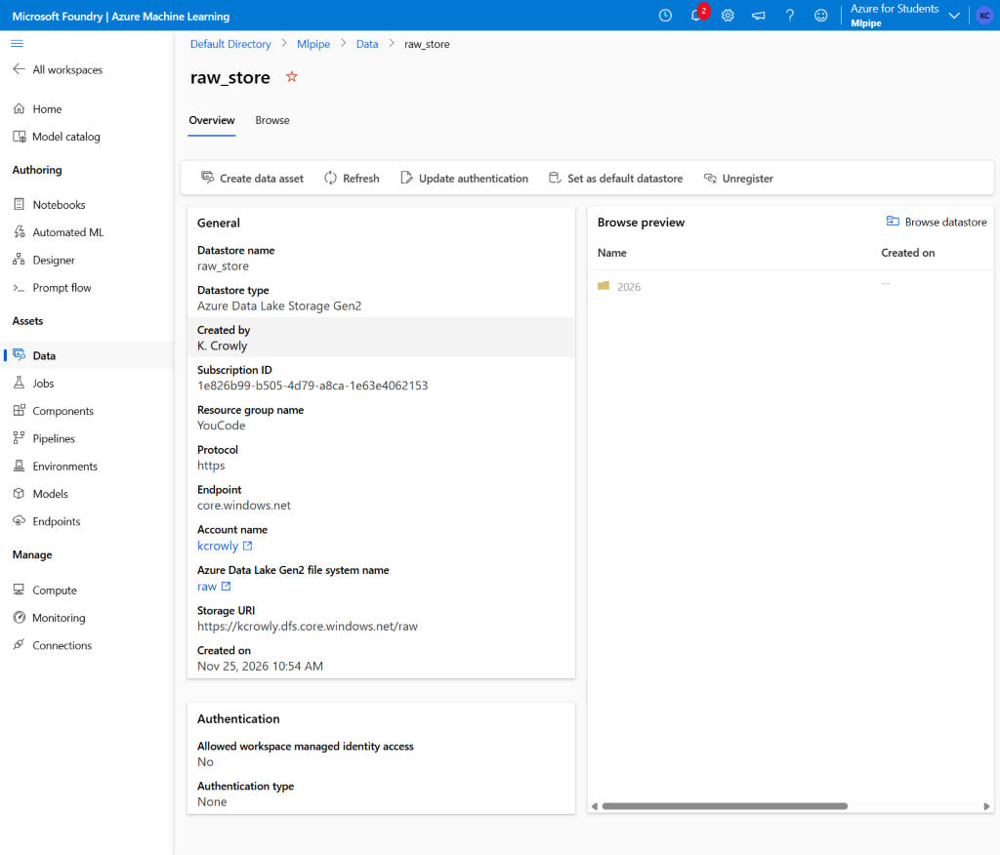

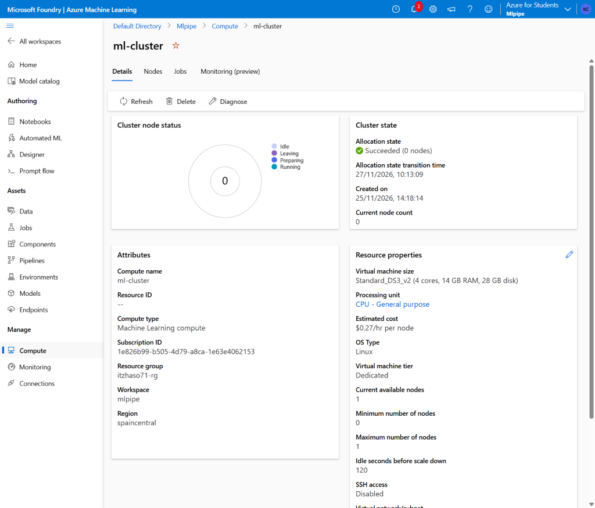

---

## Étape 4 : Création du dataset

- Création des **Data assets** dans Azure ML Studio (`Data → Data assets`) à partir du datastore `raw_store` (`raw` v1, `raw_data` v1, `data_raw` v1 — type `Folder (uri_folder)`).
- Sélection du fichier `/2026/11/24/electro.csv` (`3,882 MiB`) contenant les colonnes `Datetime` et `PJME_MW`.

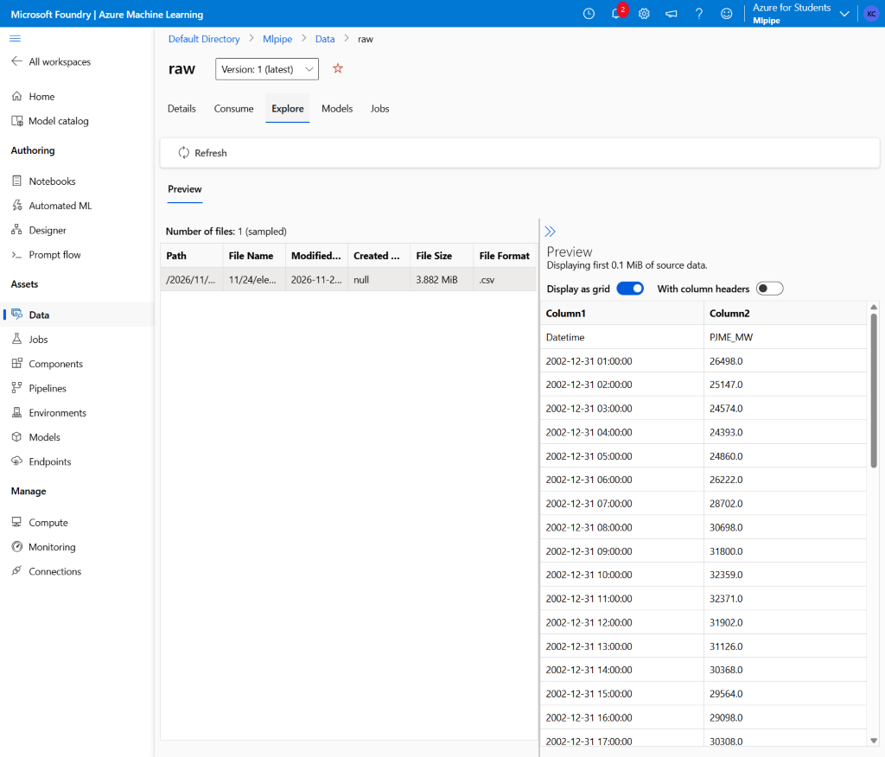

---

## Étape 5 : Création du pipeline dans Designer

- Création du pipeline `ml pipeline` dans **Azure ML Designer** à partir du data asset `data_raw` (v1).
- Exécution complète réussie dans l'expérience `final` sur `ml-cluster` (`7m 45s`, 14 nœuds au statut `Completed`).

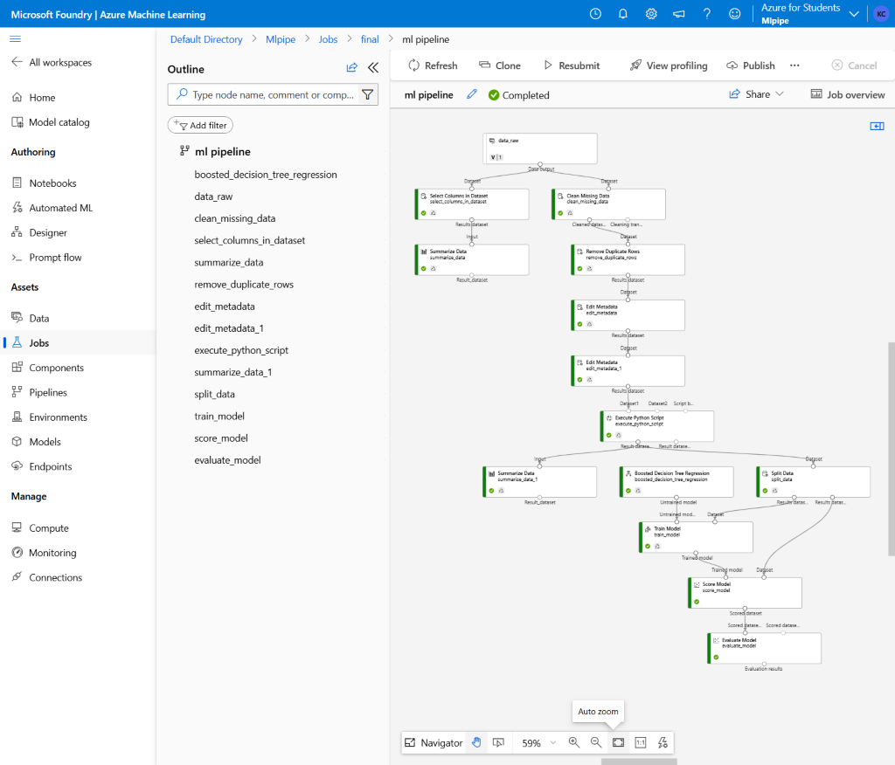

---

## Étape 6 : Nettoyage des données

- Exploration statistique via **Summarize Data** (`summarize_data`) sur le jeu brut, et nettoyage via **Clean Missing Data** (`PJME_MW`, seuils `0.0`–`1.0`, mode `Remove entire row`).
- Dédoublonnage avec **Remove Duplicate Rows** (`remove_duplicate_rows`).
- Correction des métadonnées via **Edit Metadata** (`edit_metadata` et `edit_metadata_1`, renommant notamment `PJME_MW` en `Electric_consumption`).

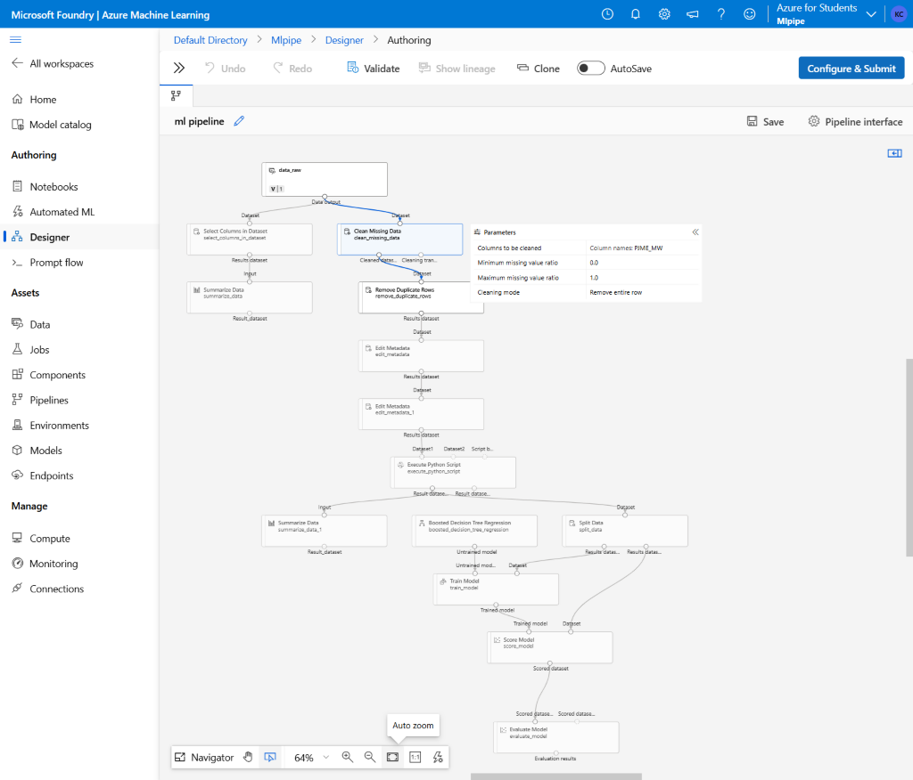

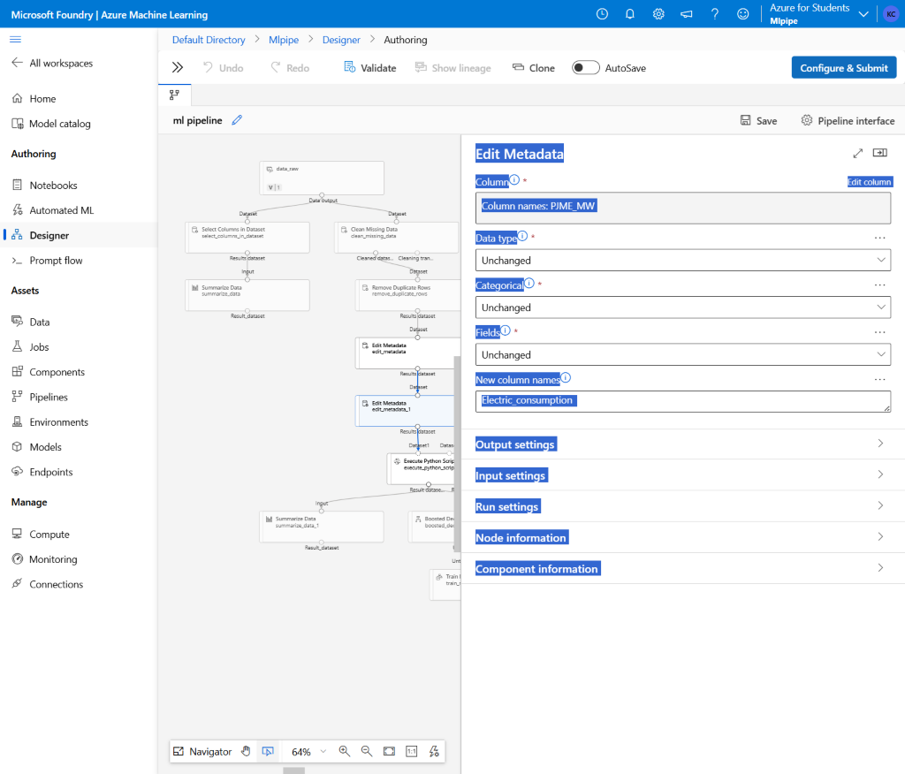

---

## Étape 7 : Feature Engineering

- Ajout du module **Execute Python Script** (`execute_python_script`) après les étapes de nettoyage et d'édition des métadonnées pour générer les variables temporelles à partir de la colonne de date.
- Contrôle statistique du jeu enrichi en aval via **Summarize Data** (`summarize_data_1`).

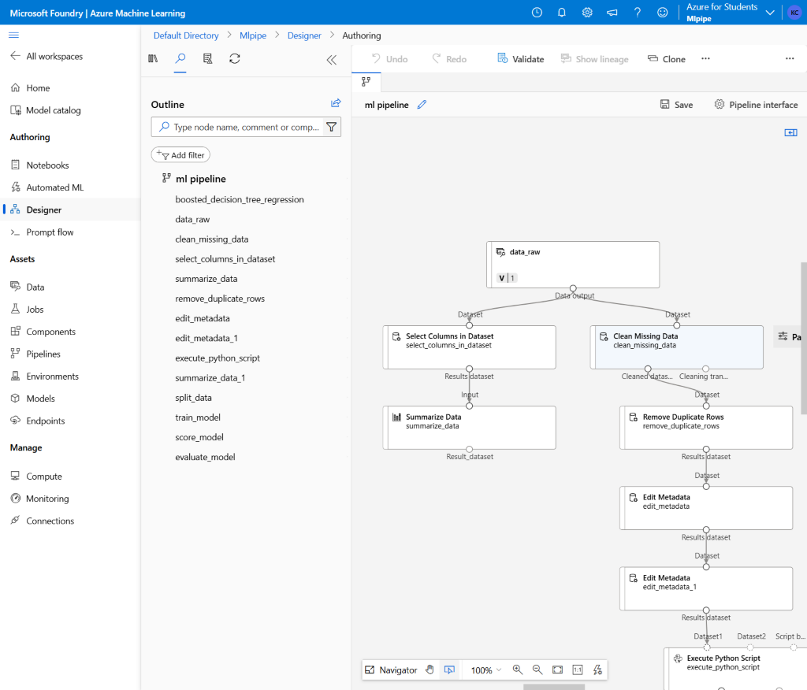

---

## Étape 8 : Préparation pour l’entraînement

- Sélection des colonnes via **Select Columns in Dataset** (`select_columns_in_dataset`).
- Séparation du jeu de données via **Split Data** (`split_data`) en deux sous-ensembles : jeu d'entraînement connecté à `Train Model` et jeu de test connecté à `Score Model`.

---

## Étape 9 : Entraînement du modèle

- Algorithme de régression choisi : **Boosted Decision Tree Regression** (`boosted_decision_tree_regression`).
- Entraînement avec **Train Model** (`train_model`) sur les données d'entraînement, puis génération des prédictions sur le jeu de test avec **Score Model** (`score_model`).

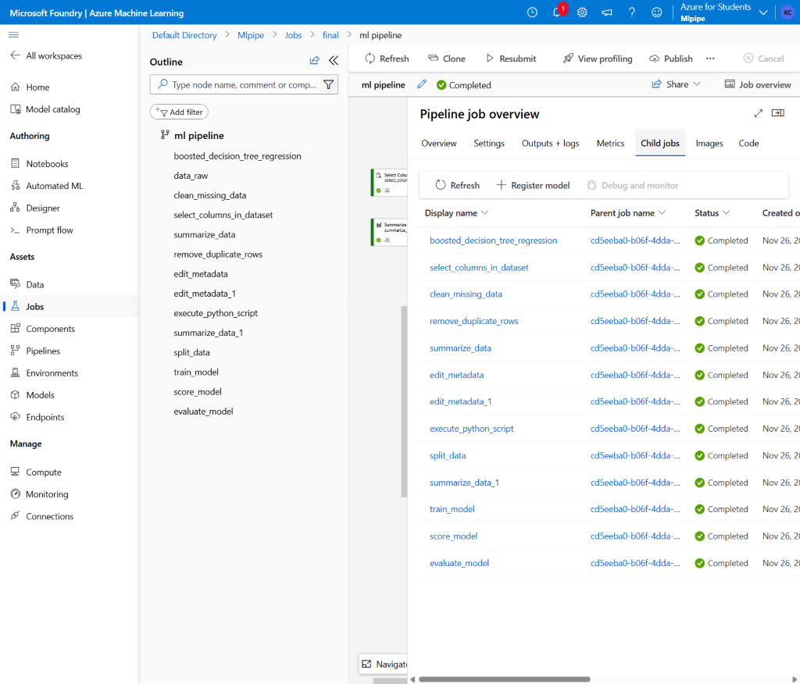

---

## Étape 10 : Évaluation du modèle

Évaluation via **Evaluate Model** (`evaluate_model`) sur les prédictions du jeu de test :

| Métrique | Valeur mesurée |
| --- | --- |
| Coefficient of Determination ($R^2$) | `0.8837558` |
| Mean Absolute Error (MAE) | `2922.386` |
| Root Mean Squared Error (RMSE) | `3828.339` |
| Relative Absolute Error (RAE) | `0.3079466` |
| Relative Squared Error (RSE) | `0.1162442` |

- **Interprétation & limites** : le modèle explique **88,4 %** de la variance ($R^2 = 0{,}884$), mais présente une erreur moyenne d'environ **2 922 MW** (RMSE plus élevé à **3 828 MW** sous l'effet des pics de charge), principalement due à l'utilisation exclusive de variables calendaires sans variables exogènes (météo) ni valeurs passées (*lags*).

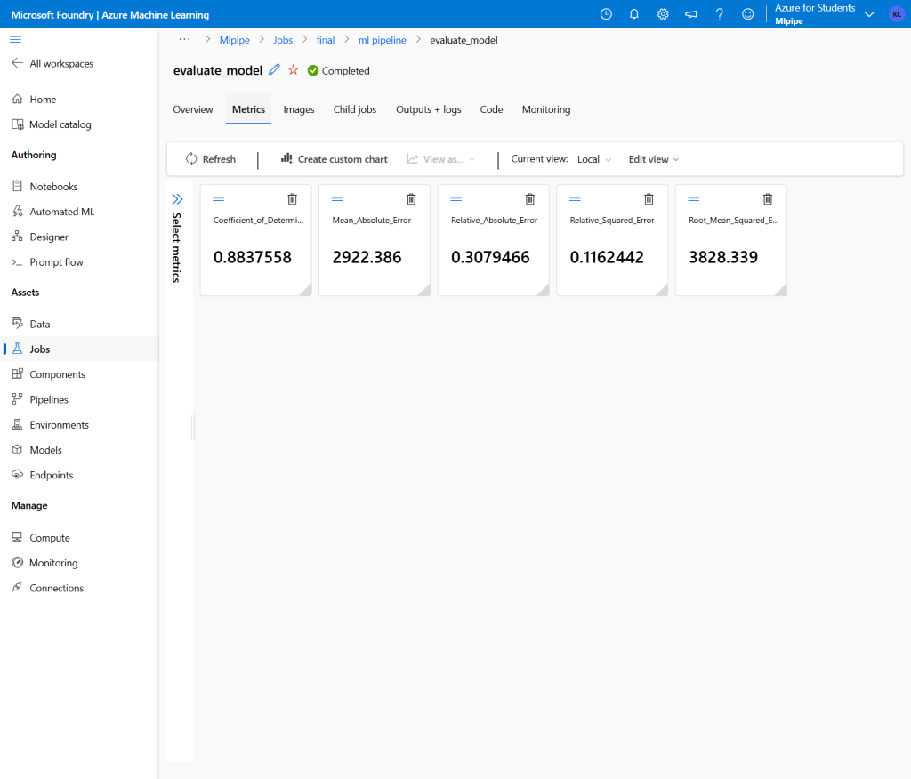

---

## Étape 11 : Enregistrement du modèle

- Enregistrement du modèle entraîné depuis **Train Model** dans le registre **Models** d'Azure Machine Learning (`Assets → Models`).
- Modèles enregistrés (type `CUSTOM`, version `1`) : `amlstudio-boomv2`, `amlstudio-boom`, `amlstudio-mlnendpoint`.

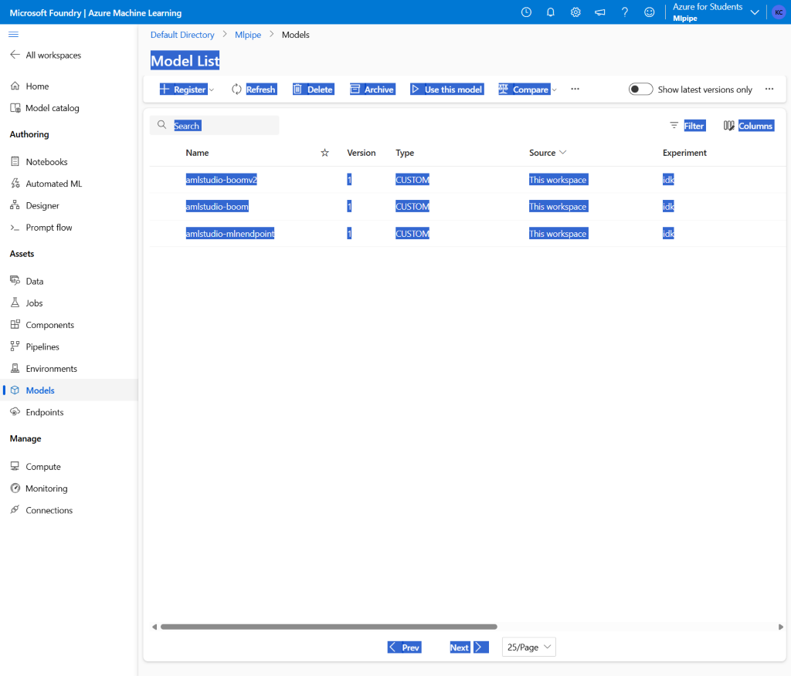

---

## Étape 12 : Création du pipeline d’inférence

- Conversion du pipeline d'entraînement en **Real-time inference pipeline** (`ml pipeline-real time inference`).
- **Modules supprimés** : `Select Columns in Dataset`, `Summarize Data`, `Split Data`, `Boosted Decision Tree Regression`, `Train Model`, `Evaluate Model`.
- **Modules conservés / ajoutés** : `Web Service Input` (et `Enter Data Manually`), transformation sauvegardée (`TD-ml_pipeline-Clean_Missing_Data...` + `Apply Transformation`), `Remove Duplicate Rows`, `Edit Metadata`, `Execute Python Script`, `Score Model` (avec le modèle entraîné `MD-ml_pipeline-Train_Model-Trained_m...` v1) et `Web Service Output`.

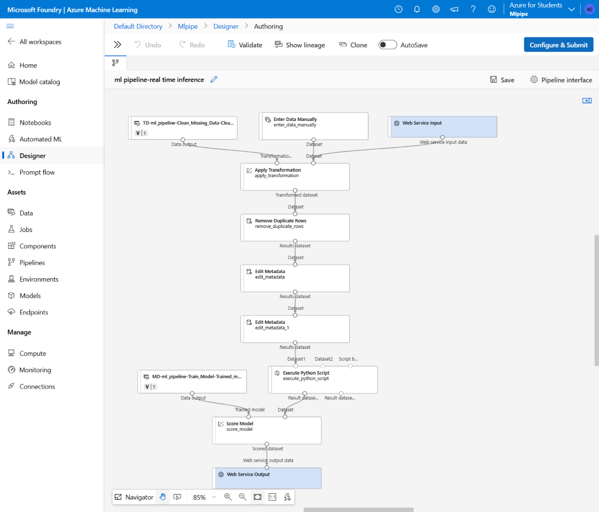
